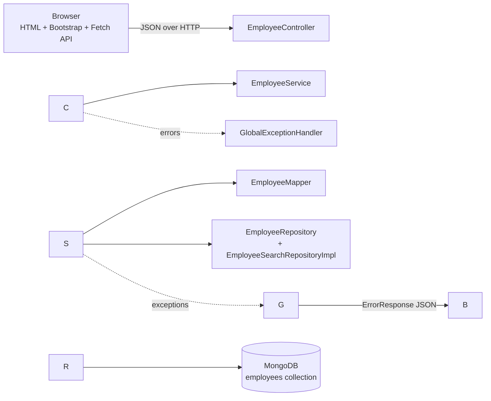

# EmployeeHub — Employee Management System

A full-stack employee administration application: a Spring Boot REST API backed by MongoDB, and a responsive Bootstrap dashboard built with vanilla JavaScript.

> \*\*Status:\*\* Source code, tests and documentation are complete. See \[Verification status](#verification-status) for exactly what has and has not been executed.

## Problem statement and goals

HR teams need a simple internal tool to keep employee records in one place and find people quickly. EmployeeHub provides:

* Registration, update, deletion and detail views for employee records
* Fast server-side search, filtering, sorting and pagination
* Dashboard statistics (headcount, status split, department and location summaries)
* A documented REST API (Swagger UI + Postman) that other systems can use

Learning goals: layered Spring Boot architecture, REST design, MongoDB integration, validation, centralised error handling, automated testing, and frontend–backend integration without a frontend framework.

## Features

**Stage 1 additions:** sign-in with roles (ADMIN / HR / EMPLOYEE, JWT + BCrypt), leave management with approvals, activity log, in-app notifications, CSV import/export, monthly joining trends, full employee profile page, reports with CSV and print/PDF. See [Roles and permissions](#roles-and-permissions) and [Stage 1 verification status](#stage-1-verification-status).

* CRUD for employees with Bean Validation and unique `employeeCode` / `email`
* Search by name, code or email; filter by department, location and status
* Pagination (page size capped at 100) and whitelisted sorting (case-insensitive collation)
* Dashboard: total, active / on leave / inactive, per-department and per-location breakdowns
* Responsive SaaS-style UI: sidebar, table, modals, delete confirmation, toasts, loading spinners, empty states
* Server-side validation and duplicate errors shown next to the form fields
* Backend-offline banner with a Retry button instead of a broken page
* Consistent JSON error format; no stack traces or database internals exposed
* Swagger UI, Actuator health endpoint, Postman collection
* Opt-in demo data via a Spring profile (never seeded automatically)

## Technology stack

|Layer|Technology|
|-|-|
|Language / runtime|Java 21|
|Framework|Spring Boot 3.3.5 (Web/MVC, Data MongoDB, Validation, Actuator)|
|Database|MongoDB (local, Docker or Atlas)|
|Security|Spring Security 6, OAuth2 Resource Server (HS256 JWT), BCrypt|
|Build|Maven|
|API docs|springdoc-openapi 2.6.0 (Swagger UI)|
|Tests|JUnit 5, Mockito, Spring MockMvc, Testcontainers (MongoDB)|
|Frontend|HTML5, CSS3, vanilla JavaScript (ES modules), Bootstrap 5.3.3 (layout/modals), Chart.js 4.4.3 and the Inter font via CDN; icons are inline SVG (no CDN)|

**Version choices:** Spring Boot 3.3.5 requires Java 17+ and supports Java 21. springdoc 2.6.0 is the release line built for Spring Boot 3.3. Testcontainers versions are managed by the Spring Boot BOM, so no version is pinned. Bootstrap and Bootstrap Icons are loaded from the jsDelivr CDN (see Known limitations).

## Architecture overview



More detail: [docs/architecture.md](docs/architecture.md).

## Folder structure

```
employeehub/
├── backend/                     Spring Boot application (Maven)
│   ├── pom.xml
│   └── src/
│       ├── main/java/com/employeehub/
│       │   ├── config/          CORS, Clock, Mongo date converters, OpenAPI, demo seeder
│       │   ├── controller/      EmployeeController
│       │   ├── service/         EmployeeService (business rules)
│       │   ├── repository/      EmployeeRepository + custom search/aggregation
│       │   ├── model/           Employee document, EmploymentStatus
│       │   ├── dto/             Request/response/error/page DTOs
│       │   ├── mapper/          EmployeeMapper
│       │   └── exception/       Custom exceptions + GlobalExceptionHandler
│       ├── main/resources/application.properties
│       └── test/java/com/employeehub/   service, controller and integration tests
├── frontend/                    Static dashboard (index.html, css/ tokens+layout+components, js/ ES modules)
├── frontend-original-backup/    Copy of the first frontend version (safe to delete once you are happy)
├── docs/                        architecture.md, resume-and-interview.md, screenshots/
├── postman/                     Importable Postman collection
├── docker-compose.yml           Local MongoDB (optional)
├── .env.example
├── .gitignore
├── LICENSE
├── CONTRIBUTING.md
└── README.md
```

## Database model and indexes

Collection `employees`:

|Field|Type|Notes|
|-|-|-|
|`\_id`|ObjectId|exposed as `id` (string)|
|`employeeCode`|string|**unique index**, stored upper-case|
|`fullName`|string|required|
|`email`|string|**unique index**, stored lower-case|
|`department`, `location`|string|required, non-unique indexes (used by filters and aggregations)|
|`jobTitle`|string|required|
|`phone`|string|optional|
|`joiningDate`|date|stored as midnight UTC; returned as `yyyy-MM-dd`|
|`employmentStatus`|string|`ACTIVE`, `ON\_LEAVE`, `INACTIVE`|
|`createdAt`, `updatedAt`|date|set by the service from an injected `Clock`|

**Index creation and its limitations**

* Spring Boot disables automatic index creation by default; this project enables it with `spring.data.mongodb.auto-index-creation=true`, so indexes are created when the app starts.
* Index creation **fails if existing documents already violate a unique index** (for example two documents with the same email). Clean up duplicates first, or create the index manually after deduplicating.
* A unique index treats a missing/`null` value as a value, so two documents without `email` also collide. Both unique fields are required by validation, but data inserted by other tools (e.g. Compass) must respect that.
* Auto index creation is convenient for development. In production, create indexes through a controlled migration and consider turning the setting off.
* The service pre-checks duplicates to return friendly field-level errors; the unique indexes remain the authoritative guard against race conditions, and `DuplicateKeyException` is translated to HTTP 409.
* Search uses a case-insensitive regex over name, code and email. Regex searches cannot use ordinary indexes efficiently, so they scan the collection. That is fine at this project's scale; for large data sets use a MongoDB text/Atlas Search index.

## REST API

Base path: `/api/employees`

|Method|Path|Description|Success|Errors|
|-|-|-|-|-|
|POST|`/api/employees`|Create employee|201 + `Location` header|400, 409|
|GET|`/api/employees`|Paged list with search, filters, sorting|200|400|
|GET|`/api/employees/{id}`|Get one employee|200|400 (bad id), 404|
|PUT|`/api/employees/{id}`|Replace editable fields|200|400, 404, 409|
|DELETE|`/api/employees/{id}`|Delete|204|400, 404|
|GET|`/api/employees/stats`|Totals, status counts, department counts|200|—|
|GET|`/api/employees/locations`|Employees per location|200|—|
|GET|`/api/employees/trends?months=12`|Joined-per-month series|200|-|
|GET|`/api/employees/designations`|Distinct job titles|200|-|
|GET|`/api/employees/export`|CSV of all matches (same filters as list)|200|400|
|POST|`/api/employees/import`|CSV import (multipart `file`)|200 summary|400, 413|
|POST|`/api/auth/login`|Sign in|200 + token|401, 403 (locked)|
|GET|`/api/auth/me`, `/api/me/employee`|Current user / own employee record|200|401, 404|
|POST|`/api/leaves`|Apply for leave|201|400, 409|
|GET|`/api/leaves`, `/api/leaves/mine`|All requests (ADMIN/HR) / my history|200|403|
|POST|`/api/leaves/{id}/approve` or `/reject`|Decide a pending request|200|403, 404, 409|
|GET|`/api/leaves/on-leave-today`, `/api/leaves/summary`|Dashboard / report data|200|403|
|GET|`/api/activity`|Audit trail (ADMIN/HR)|200|403|
|GET/POST|`/api/notifications`, `/unread-count`, `/{id}/read`, `/read-all`|In-app notifications|200/204|401|
|GET/POST/PATCH|`/api/users`|Account administration (ADMIN)|200/201|403, 409|
|GET|`/actuator/health`|Health check (public)|200|503 when unhealthy|

**List query parameters:** `designation` (exact job title) in addition to the ones below; `search` also matches department. `page` (default 0), `size` (default 10, clamped to 1–100), `sortBy` (`fullName`, `employeeCode`, `email`, `department`, `jobTitle`, `location`, `joiningDate`, `employmentStatus`, `createdAt`, `updatedAt`; default `createdAt`), `direction` (`asc`/`desc`, default `desc`), `search`, `department`, `location`, `status`.

**Error format (all failures):**

```json
{
  "timestamp": "2026-01-15T10:00:00Z",
  "status": 400,
  "error": "Bad Request",
  "message": "Validation failed",
  "path": "/api/employees",
  "fieldErrors": \[ { "field": "email", "message": "Email must be a valid address" } ]
}
```


## Roles and permissions

Authentication uses short-lived Bearer tokens (JWT, HS256) issued by `POST /api/auth/login`. Passwords are stored only as BCrypt hashes. The **server** enforces every rule below (`@PreAuthorize`); hiding menu items in the browser is only a convenience.

|Capability|ADMIN|HR|EMPLOYEE|
|-|:-:|:-:|:-:|
|View dashboard, directory, reports, activity log|yes|yes|no|
|Create / edit employees, CSV import / export|yes|yes|no|
|Delete employees|yes|no|no|
|Apply for leave|yes (on behalf of anyone)|yes (on behalf of anyone)|own leave only|
|Approve / reject leave|yes|yes|no (and nobody can decide their own request)|
|See all leave requests|yes|yes|own history only|
|View own employee record (`/api/me/employee`)|if linked|if linked|yes|
|Create / enable / disable user accounts|yes|no|no|
|Notifications|own|own|own|

Other protections: 5 failed logins lock an account for 15 minutes (in memory, resets on restart); login errors never reveal whether a username exists; CORS only allows `CORS\_ALLOWED\_ORIGINS`; CSRF protection is disabled on purpose because the API is stateless and uses Bearer tokens, not cookies; emergency-contact data is never exported to CSV; the activity log stores no passwords or tokens. Tokens are kept in `sessionStorage` (cleared when the tab closes). That is convenient but readable by any script on the page, so a production deployment should add a strict Content-Security-Policy and HTTPS, or move the token to an HttpOnly cookie.

### Creating the first administrator

There is no public registration and no default password. On startup, if the `users` collection is empty, the backend creates one ADMIN from two environment variables (password at least 10 characters):

```powershell
cd backend
$env:EMPLOYEEHUB\_ADMIN\_USERNAME = "admin"
$env:EMPLOYEEHUB\_ADMIN\_PASSWORD = "choose-a-long-unique-password"
$env:EMPLOYEEHUB\_JWT\_SECRET     = "at-least-32-random-characters-go-here!!"
mvn spring-boot:run
```

Sign in at [http://localhost:5500](http://localhost:5500), then restart the backend **without** `EMPLOYEEHUB\_ADMIN\_PASSWORD`. Create HR and EMPLOYEE accounts from **User Accounts** (EMPLOYEE accounts must be linked to an existing employee code).

## Leave, activity and notifications

* **Leave rules:** type (annual, sick, casual, unpaid, other), inclusive start/end dates, reason of 5-500 characters. End may not precede start, a request may span at most 90 days, may start at most 30 days in the past, and may not overlap that employee's pending or approved requests (HTTP 409). Only pending requests can be decided. Day counts are inclusive calendar days; there is no weekend/holiday policy, so **leave balances are intentionally not implemented**.
* **Dashboard integration:** "On leave today" lists employees with *approved* leave covering today. The "On leave" KPI still reflects each employee's `employmentStatus` field; approving leave does not change it.
* **Activity log:** employee created/updated/deleted/imported/exported, leave submitted/approved/rejected, user created/enabled/disabled, login success/failure. Page size is capped at 100.
* **Notifications:** in-app only (bell icon). Leave submissions notify ADMIN and HR; decisions notify the requester. **No e-mail is sent.**

## CSV import and export

* **Export** (Employees page, Reports page): downloads every record matching the current search/filters/sort (up to 50,000), UTF-8, with cells that start with `=`, `+`, `-` or `@` prefixed by `'` to block spreadsheet formula injection. Emergency-contact data is excluded.
* **Import:** upload a CSV (max 2 MB, 1000 rows). Required columns `employeeCode, fullName, email, department, jobTitle, location, joiningDate (yyyy-MM-dd)`; optional `phone, employmentStatus` (default ACTIVE), `reportingManager`. Each row is validated with the same rules as the form; duplicates inside the file or already in the database are skipped. Valid rows are saved and every rejected row is listed with its row number. Use "Download a CSV template" in the dialog.

## Reports

Reports page: employee directory (with department/location/status filters), headcount by department, headcount by location, employment status, joining trends (6-36 months) and leave summary. Each can be downloaded as CSV; **Print / Save as PDF** opens the browser print dialog with a print-optimised layout (no PDF library is added). The directory preview shows the first 100 rows; its CSV contains all matches. The headcount reports always use all employees and ignore the filters.

## Prerequisites

* JDK 21 (a full JDK, not only a JRE)
* Maven 3.9+ (the Maven Wrapper is not included; see note below)
* MongoDB 6/7 locally, **or** Docker, **or** a MongoDB Atlas cluster
* Python 3 or Node.js (only to serve the static frontend), or any static file server
* Docker (optional; required only for the Testcontainers integration tests)

> \*\*Maven Wrapper:\*\* the wrapper files (`mvnw`, `.mvn/`) could not be generated in the environment this project was built in. After installing Maven once, run `cd backend \&\& mvn wrapper:wrapper` to generate them, then use `./mvnw` (Linux) or `mvnw.cmd` (Windows) instead of `mvn`.

## MongoDB setup

**Option A — Docker (simplest):**

```bash
docker compose up -d        # starts MongoDB on 127.0.0.1:27017
```

**Option B — Local install:** install MongoDB Community Edition and make sure `mongod` is running on port 27017. MongoDB Compass can connect to `mongodb://localhost:27017`.

**Option C — MongoDB Atlas:** create a free cluster, create a database user, allow your IP in *Network Access*, copy the `mongodb+srv://…` connection string, include the database name (e.g. `/employeehub`) and set it as `MONGODB\_URI`. Never commit that string.

## Environment variables

|Variable|Default|Purpose|
|-|-|-|
|`MONGODB\_URI`|`mongodb://localhost:27017/employeehub`|MongoDB connection string|
|`PORT`|`8080`|Backend port|
|`CORS\_ALLOWED\_ORIGINS`|`http://localhost:5500,http://127.0.0.1:5500`|Origins allowed to call `/api/\*\*`|
|`SPRING\_PROFILES\_ACTIVE`|*(none)*|Set to `demo` to insert 12 sample employees **only if the collection is empty**|

Spring Boot does not read `.env` files automatically. Set variables in your shell, as below. See [.env.example](.env.example).

## Run the backend

**Linux / macOS**

```bash
cd backend
export MONGODB\_URI="mongodb://localhost:27017/employeehub"
mvn spring-boot:run
```

**Windows PowerShell**

```powershell
cd backend
$env:MONGODB\_URI = "mongodb://localhost:27017/employeehub"
mvn spring-boot:run
```

**Windows cmd**

```bat
cd backend
set MONGODB\_URI=mongodb://localhost:27017/employeehub
mvn spring-boot:run
```

Optional demo data (empty database only): `export SPRING\_PROFILES\_ACTIVE=demo` (PowerShell: `$env:SPRING\_PROFILES\_ACTIVE="demo"`) before starting.

Build a runnable jar: `mvn clean package` then `java -jar target/employeehub-backend-1.0.0.jar`.

## Run the frontend

The frontend is static. Serve the `frontend/` folder on port **5500** (the default allowed CORS origin):

```bash
cd frontend
python -m http.server 5500        # Windows: py -m http.server 5500
# or: npx serve -l 5500 .
```

Open [http://localhost:5500](http://localhost:5500). The app uses ES modules, so it must be served over HTTP (not opened as a `file://` page). The backend URL is configured in `frontend/js/config.js` (`API\_BASE\_URL`). If you serve the frontend from a different origin, add that origin to `CORS\_ALLOWED\_ORIGINS`.

## Database changes in Stage 1

New collections (created on demand): `users`, `leave\_requests`, `activity\_logs`, `notifications`. The `employees` collection gains three **optional** fields (`reportingManager`, `emergencyContactName`, `emergencyContactPhone`); existing documents without them keep working and the API returns `null` for them. No data is migrated, reset or deleted. New indexes (unique `users.username`, plus lookup indexes) are created automatically at startup.

## Run the tests

```bash
cd backend
mvn test
```

* `EmployeeServiceTest` — Mockito unit tests of business rules.
* `EmployeeControllerTest` — `@WebMvcTest` tests of HTTP status codes, validation and the error format.
* `EmployeeApiIntegrationTest` — full-stack tests against a disposable MongoDB 7 container via Testcontainers. It is **skipped automatically when Docker is not available**. To run it, start Docker and re-run `mvn test`. It never touches your local database.

## Swagger UI

[http://localhost:8080/swagger-ui/index.html](http://localhost:8080/swagger-ui/index.html) (`/swagger-ui.html` redirects there; OpenAPI JSON at `/v3/api-docs`).

## Postman

Import `postman/EmployeeHub.postman\_collection.json`. It defines a `baseUrl` variable (default `http://localhost:8080`). Run **Create employee** first; its test script stores the new id in `employeeId`, which the get/update/delete requests reuse.

## Screenshots


\### Dashboard


\### Employee Management


\### API Documentation


## Verification status

|Item|Status|
|-|-|
|Frontend JavaScript syntax (`node --check`) and HTML/JS element-id cross-check|Executed, passed|
|Java sources parsed for syntax errors (30 files)|Executed, passed|
|Postman collection is valid JSON|Executed, passed|
|`mvn compile` / `mvn test` (unit, controller tests)|**Not executed** — the build environment had no Maven, no network access to Maven Central, and only a JRE-level toolchain. Run `mvn test` locally.|
|Integration tests against MongoDB (Testcontainers)|**Not executed** — no Docker. Run locally with Docker running.|
|End-to-end UI workflows in a browser (CRUD, filters, pagination, refresh persistence)|**Not executed** — no MongoDB or browser available. Follow the manual checklist in [docs/architecture.md](docs/architecture.md#manual-verification-checklist).|

Treat this project as "written and reviewed, awaiting your first local build". Fix anything the first `mvn test` reports before publishing or putting it on a resume.


## Stage 1 verification status

|Item|Status|
|-|-|
|Java syntax of all 80 backend files (parse-only)|Executed, passed|
|`mvn compile` / `mvn test` for all new backend code (security, leave, activity, notifications, CSV, trends)|**Not executed.** The build environment has no Maven, JDK compiler classpath or network, so the Java has never been compiled. Expect to fix small compile errors on your first `mvn test`.|
|Unit tests written: leave rules, auth/lockout, CSV, import, trends, export, controller mappings|Written, **not run**|
|`SecurityIntegrationTest` (401/403, roles, leave workflow, notifications, CORS) against MongoDB via Testcontainers|Written, **not run** (needs Docker)|
|Frontend flows (login, role navigation, leave, notifications, import/export, profile page, reports, users, session expiry, offline, overflow at 1920/1440/1366/768/390)|Executed in headless Chromium: **77 of 77 checks passed, against a stand-in API I wrote that imitates the contract. It is not your Spring backend.**|
|Chart.js rendering|Not verified (library unavailable offline; a recording stand-in was used)|
|Dark mode|**Not implemented**|
|Screenshots of the real running app|Not captured (see `docs/screenshots/`)|

## Troubleshooting

* **"Cannot reach the server"** banner: the backend is not running or `API\_BASE\_URL` in `frontend/js/config.js` is wrong.
* **Login says invalid credentials on a fresh database:** the first admin is only created when `EMPLOYEEHUB\_ADMIN\_USERNAME` and `EMPLOYEEHUB\_ADMIN\_PASSWORD` (10+ characters) were set at startup and no users existed. Check the backend log for the warning.
* **Signed out after every backend restart:** set `EMPLOYEEHUB\_JWT\_SECRET` (32+ characters).
* **Browser CORS error:** add your frontend origin to `CORS\_ALLOWED\_ORIGINS`.
* **Index creation fails at startup:** existing duplicate emails or employee codes (see "Database model and indexes").

## Known limitations

* No password reset, e-mail notifications, multi-factor authentication or leave balances/policies
* Login lockout counters are in memory (reset on restart, not shared between instances)
* No dark mode
* Bootstrap, Chart.js and the Inter font load from CDNs (icons are inline SVG). If Chart.js fails to load, the dashboard still shows all numbers, the department breakdown and the recent-employees table; only the three chart cards show an error state, so the UI needs internet access unless you vendor those files
* Regex-based search scans the collection; fine for thousands of records, not millions
* Enum query parameters (`status`) are case-sensitive (`ACTIVE`, not `active`)
* No audit trail, soft delete, bulk import/export or file uploads
* Maven Wrapper not generated (see Prerequisites)

## Future improvements

* Refresh tokens / HttpOnly cookie sessions, password reset and MFA
* Leave policy and balances, e-mail notifications
* MongoDB text/Atlas Search index for scalable search
* CSV import/export, soft delete and audit history
* Dockerfile for the backend and a full `docker compose` stack
* GitHub Actions workflow running `mvn verify`
* Frontend end-to-end tests (Playwright)

## Production checklist

* \[ ] Add authentication, authorisation and HTTPS (reverse proxy or platform TLS)
* \[ ] Use a MongoDB user with least privilege, IP allow-listing and TLS; keep the URI in the platform's secret store
* \[ ] Set `CORS\_ALLOWED\_ORIGINS` to the real frontend origin only
* \[ ] Create indexes through a migration and consider `auto-index-creation=false`
* \[ ] Update `frontend/js/config.js` with the production API URL
* \[ ] Restrict Swagger UI and Actuator exposure (or disable Swagger) in production
* \[ ] Enable MongoDB backups and monitoring; check `/actuator/health` from your host's health probe
* \[ ] Ensure logs contain no personal data

## Deployment notes

* **Database:** MongoDB Atlas free tier is the simplest hosted option.
* **Backend:** any host that runs a Java 21 jar (Render, Railway, Fly.io, Azure App Service, AWS Elastic Beanstalk). Build with `mvn clean package`, start with `java -jar target/employeehub-backend-1.0.0.jar`, set `MONGODB\_URI`, `PORT` (if the platform assigns one) and `CORS\_ALLOWED\_ORIGINS` as environment variables, and use `/actuator/health` as the health check.
* **Frontend:** upload the `frontend/` folder to any static host (GitHub Pages, Netlify, Cloudflare Pages) after setting `API\_BASE\_URL` in `js/config.js`.
* This repository has **not** been deployed; no live URL exists.

## License and acknowledgements

Released under the [MIT License](LICENSE). Built with Spring Boot, Spring Data MongoDB, springdoc-openapi, Testcontainers, Bootstrap and Bootstrap Icons — each under its own open-source licence.

